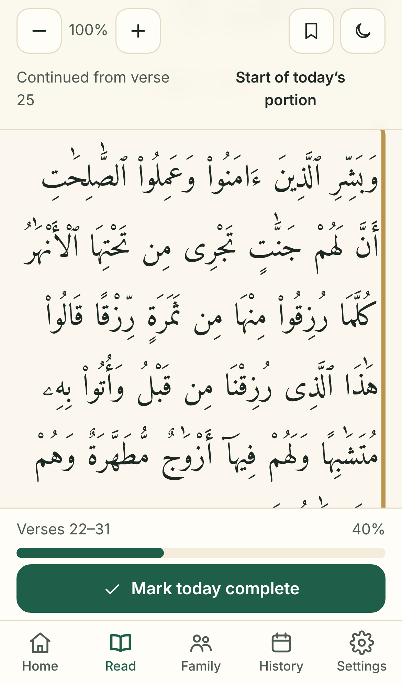
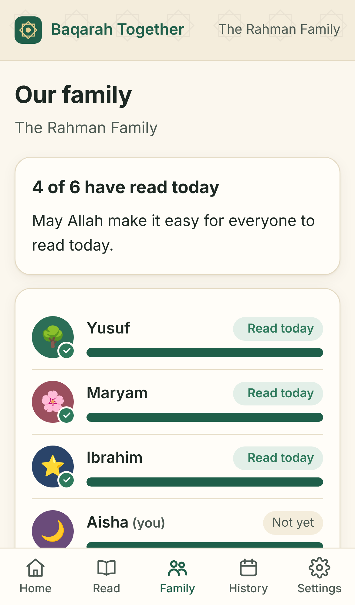

# Baqarah Together

A private, mobile-friendly web app for a family of six to read **Surah Al-Baqarah** every day, track their own progress, and encourage one another gently, without rankings or pressure.

> This application is a reading and tracking tool. It is not a source of religious rulings.

Plan, architecture, flows, schema and sources: **[docs/PLAN.md](docs/PLAN.md)**

| Home | Reader | Family | Arabic, dark mode |
|---|---|---|---|
|  |  |  |  |

## What works today (phase 1)

* Private family group: administrator + up to 5 invited members; one-time invite links; PIN sign-in; PIN reset links.
* Reader with verified Uthmani Arabic text (Tanzil, used verbatim), verse ornaments, page/juz markers, adjustable text size, light/dark mode, bookmarks, automatic saving of your place, and "continue from where I stopped".
* Reading paces: at my own pace (default), whole Surah daily, N verses per day, or finish over N days.
* Daily completion (with undo), streak, days read, verses read, full readings, and gentle wording for missed days.
* Family dashboard: who has read today, each person's progress today, this week, the last 30 days, and shared totals. Encouraging messages, fixed member order, no leaderboard.
* English / Arabic (RTL) interface, accessible controls, phone/tablet/desktop layouts, installable as an app.
* Download my data, delete my account.

Coming next: reminders (web push), audio recitation, translations, reflections, and family goals. The database tables are already in place.

## Run it locally

Requires **Node.js 22.13+** (uses the built-in `node:sqlite`).

```bash
npm install
npm run build
npm run seed:demo      # optional: sample family of six
npm start              # http://localhost:3000  (use `node server/index.js` for plain-HTTP local testing)
```

Demo sign-ins: `yusuf` / `482915` (administrator); `maryam`, `ibrahim`, `aisha`, `zaynab`, `omar` / `2468`.

For development with hot reload: `node --watch server/index.js` in one terminal and `npx vite` in another (opens on port 5173 and forwards `/api` to 3000).

## Use it for your real family

1. Deploy with an **empty** database (don't run `seed:demo`).
2. On first start, the server log prints: `First-time setup: open /setup and enter setup code 123456789012`. You can also set `SETUP_CODE` yourself.
3. Open `https://your-domain/setup`, create the family and your administrator account.
4. Settings → **Family administration** → add each person and send them their invite link.

To replace the demo with real people, delete `var/baqara.db` (or the Docker volume) and follow the steps above.

## Deploy

```bash
docker build -t baqarah .
docker run -p 3000:3000 -v baqarah-data:/data baqarah
```

* Put it behind **HTTPS** (most hosts do this automatically). In production, cookies are marked `Secure` and the browser is told to always use HTTPS.
* Environment: `PORT` (3000), `DB_FILE` (`/data/baqara.db` in Docker), `SETUP_CODE` (optional).
* Back up the single database file (and its `-wal` file) regularly.

## Tests

```bash
npm test            # 34 API tests: auth, invitations, 6-member cap, permissions, isolation, progress, time zones, errors
npm run build && npm run test:e2e   # 9 browser tests (Playwright/Chromium): exact Arabic text, autosave, completion, invites, RTL, dark mode, responsive
npm run verify:quran  # checksum of the stored Quran text
```

## Quran text attribution

Arabic text: **Tanzil Quran Text (Uthmani, v1.1)**, Copyright © 2007-2026 Tanzil Project, [tanzil.net](https://tanzil.net). CC BY 3.0, verbatim copying only. The full notice is kept in `data/al-baqarah.json`. Mushaf page numbers: [Quran.com](https://quran.com). Font: Amiri Quran (SIL OFL).
