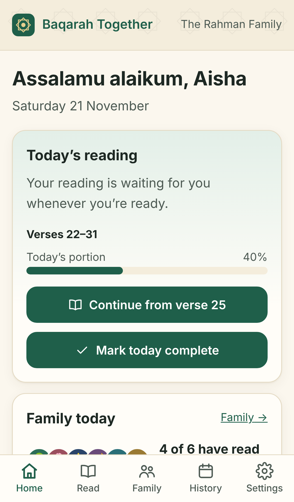

# Baqarah Together

A private, mobile-friendly web app for a family of six to read **Surah Al-Baqarah** every day, track their own progress, and encourage one another gently, without rankings or pressure.

> This application is a reading and tracking tool. It is not a source of religious rulings.

Plan, architecture, flows, schema and sources: **[docs/PLAN.md](docs/PLAN.md)**

| Home | Reader | Family | Arabic, dark mode |
|---|---|---|---|
|  |  |  |  |

## What works today (phase 1)

* Private family group: administrator + up to 5 invited members; one-time invite links; PIN sign-in; PIN reset links.
* Reader with verified Uthmani Arabic text (Tanzil, used verbatim), verse ornaments, page/juz markers, adjustable text size, light/dark mode, bookmarks, automatic saving of your place, and "continue from where I stopped".
* **Today's family goal: the whole Surah every day.** Al-Baqarah is split into six parts of 6, 6, 9, 9, 9 and 9 pages (mushaf pages 2–49). Each day, on Home, members take a part; everyone immediately sees who took which part, and each part is marked as read. Parts are free again every day at midnight (family time zone). A member can take more than one part if someone is away; the administrator can free a part that was taken but not read.
* **Full page view:** one mushaf page fills the screen with no scrolling. The text size adjusts automatically so the whole page fits on any phone, tablet or desktop. Swipe or tap to turn pages (Arabic direction). The choice is remembered.
* Other reading paces: at my own pace, whole Surah daily, N verses per day, or finish over N days.
* Daily completion (with undo), streak, days read, verses read, full readings, and gentle wording for missed days.
* Family dashboard: today's shared reading (48 pages, which parts are read), who has read today, each person's progress today, this week, the last 30 days, and shared totals. Encouraging messages, fixed member order, no leaderboard.
* **Gentle reminders (web push):** a daily reminder at the family time or your own time (with the family's progress), quiet days, an optional evening follow-up only if your part isn't read yet, and one celebration when the family completes the Surah. Never sent after you've read, never more than twice a day, in English or Arabic. The administrator chooses the time, message, quiet days, follow-up and celebration for the whole family; members only allow notifications on their phone from Home. Works on Android (Chrome) and iPhone (added to the Home Screen, iOS 16.4+). On free hosting, a free wake-up service keeps reminders on time (see the guide).
* English / Arabic (RTL) interface, accessible controls, phone/tablet/desktop layouts, installable as an app.
* Download my data, delete my account.

Coming next: audio recitation, translations, reflections, and family goals. The database tables are already in place.

## Run it locally

Requires **Node.js 20+**. Data is stored in a local SQLite file by default (`var/baqara.db`), or in Turso when `DATABASE_URL` is set.

```bash
npm install
npm run build
npm run seed:demo      # optional: sample family of six
npm start              # http://localhost:3000  (use `node server/index.js` for plain-HTTP local testing)
```

Demo sign-ins: `yusuf` / `482915` (administrator); `maryam`, `ibrahim`, `aisha`, `zaynab`, `omar` / `2468`.

For development with hot reload: `node --watch server/index.js` in one terminal and `npx vite` in another (opens on port 5173 and forwards `/api` to 3000).

## Use it for your real family

1. Deploy with an **empty** database (don't run `seed:demo`).
2. On first start, the server log prints (on Render, use the SETUP_CODE shown under Environment): `First-time setup: open /setup and enter setup code 123456789012`. You can also set `SETUP_CODE` yourself.
3. Open `https://your-domain/setup`, create the family and your administrator account.
4. Settings → **Family administration** → add each person and send them their invite link.

To replace the demo with real people, delete `var/baqara.db` (or the Docker volume) and follow the steps above. The demo data is only ever written to a local file, never to Turso.

## Deploy

**Free hosting (recommended):** Render (free web service) + Turso (free database). Step-by-step guide: **[docs/DEPLOY-FREE.md](docs/DEPLOY-FREE.md)**. The `render.yaml` blueprint sets almost everything up.

**Your own server or Docker:**

```bash
docker build -t baqarah .
docker run -p 3000:3000 -v baqarah-data:/data baqarah
```

* Put it behind **HTTPS** (most hosts do this automatically). In production, cookies are marked `Secure` and the browser is told to always use HTTPS.
* Environment: `PORT` (3000), `DATABASE_URL` (`file:/data/baqara.db` in Docker, or `libsql://…` for Turso), `DATABASE_AUTH_TOKEN` (Turso only), `SETUP_CODE` (optional).
* Back up regularly: Settings → Family administration → **Download family backup**, or copy the database file.

## Tests

```bash
npm test            # 59 API tests: auth, invitations, 6-member cap, permissions, isolation, progress, time zones, errors
npm run build && npm run test:e2e   # 15 browser tests (Playwright/Chromium): exact Arabic text, autosave, completion, invites, RTL, dark mode, responsive
npm run verify:quran  # checksum of the stored Quran text
```

## Quran text attribution

Arabic text: **Tanzil Quran Text (Uthmani, v1.1)**, Copyright © 2007-2026 Tanzil Project, [tanzil.net](https://tanzil.net). CC BY 3.0, verbatim copying only. The full notice is kept in `data/al-baqarah.json`. Mushaf page numbers: [Quran.com](https://quran.com). Font: Amiri Quran (SIL OFL).
